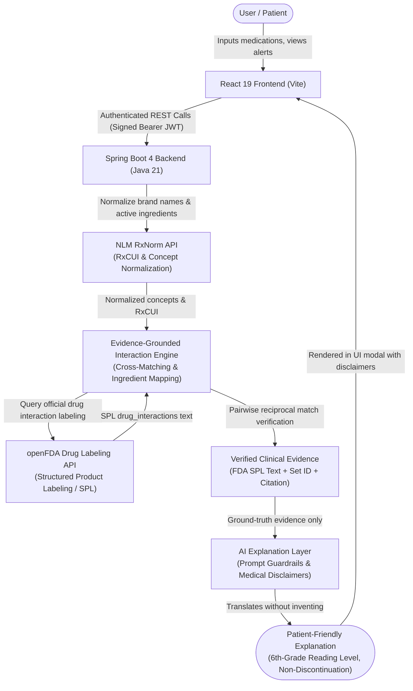

# System Architecture & Evidence Pipeline

## Overview

The **Medication Safety & Interaction Assistant** is built upon a deterministic clinical evidence pipeline and an explain-only Artificial Intelligence tier. The architecture separates the clinical source of truth from natural language explanation.

---

## 1. End-to-End Dataflow Diagram

---

## 2. Step-by-Step Flow Breakdown

1. **User Interaction**:
   - The patient registers/logs in and manages their prescribed medications, schedules, and adherence history through the responsive React single-page application.
2. **React Frontend**:
   - Manages client-side state, form input validations (such as end date order checks), and communicates with the backend via Axios with Bearer token authentication.
3. **Spring Boot Backend**:
   - Validates requests, enforces user authorization (IDOR prevention), hashes passwords with BCrypt, signs tokens with HMAC-SHA256, and coordinates services.
4. **RxNorm Normalization**:
   - The backend passes entered medication names to the National Library of Medicine (NLM) RxNorm REST API.
   - Extracts standard clinical concepts, RxCUI identifiers, brand-to-generic mappings, and active chemical ingredients.
   - Flags ambiguous formulations (e.g., Metoprolol Succinate vs. Tartrate) with status `AMBIGUOUS`.
5. **Evidence-Grounded Interaction Engine**:
   - Coordinates pairwise checking across prescribed active medications.
   - Decomposes multi-ingredient drugs and checks for duplicate active ingredients (e.g., ibuprofen in Advil and Motrin).
6. **openFDA Drug Labeling**:
   - Queries the official FDA Structured Product Labeling (SPL) database for the queried drug concept's `drug_interactions` section.
7. **Verified Evidence Synthesis**:
   - The engine performs strict reciprocal pairwise matching: it verifies that the label text of Drug A explicitly references Drug B or its active ingredient/synonyms.
   - If found, it produces a `VERIFIED` evidence result referencing the exact FDA SPL Set ID.
   - If not found, it produces a deterministic `NOT_FOUND` result stating *"No interaction identified in the consulted source"*, without ever making unverified claims of "complete safety".
8. **AI Explanation Layer**:
   - The `DefaultAIExplanationService` receives **only** the verified clinical text and source citations.
   - Mock data and synthetic sources are strictly rejected (`BadRequestException`).
   - Translates complex pharmacology into patient-friendly language while strictly preserving regulatory severity ratings.
9. **Patient-Friendly Explanation**:
   - Output contains an easy-to-read overview, clear safety directives, mandatory disclaimers, and strong instructions **never** to discontinue medications without direct physician consultation.

---

## 3. Component Interaction Matrix

| Component | Responsibility | Boundary / Guardrail |
|---|---|---|
| **Auth Filter & Token Service** | Stateless Bearer token verification | Constant-time `MessageDigest.isEqual`, no diagnostic backdoors |
| **Medication Service** | Prescription lifecycle & validation | Ownership validation (`securityUtils.getCurrentUserId()`), date order validation |
| **Duplicate Detection Service** | Brand name active ingredient comparison | Flags duplicate active entities without altering or deleting prescriptions |
| **RxNorm Provider** | Drug concept & RxCUI lookup | Distinguishes exact, normalized, ambiguous, and unknown drugs |
| **openFDA Provider** | Official SPL label retrieval | Caches drug info locally in MySQL; timeout-safe fallback |
| **Interaction Engine** | Bidirectional pairwise matching | Requires explicit pair mention; rejects one-sided section presence |
| **AI Explanation Service** | Patient translation | Grounded in verified evidence only; strictly prohibits medical advice or discontinuation commands |
| **Global Exception Handler** | Error interception | Strips stack traces, class names, and raw SQL from all client responses |
